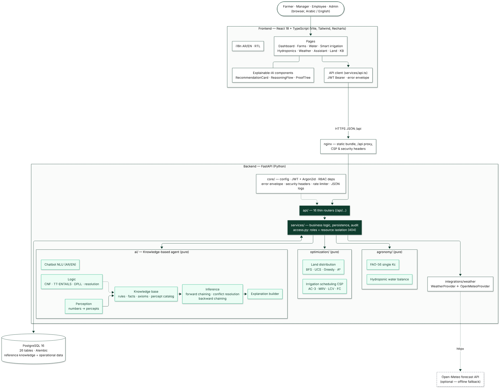

# Architecture

WO — Water Optimization is a **Knowledge-Based Intelligent Decision Support System** for agricultural water
management. It is a classic three-tier web application whose decision core is a symbolic AI agent (no machine
learning, no generative AI).



Source: [uml/01-high-level-architecture.mmd](uml/01-high-level-architecture.mmd).

## 1. Runtime topology

```text
Browser (React SPA, AR/EN + RTL)
   │  HTTPS / JSON, Authorization: Bearer <JWT>
   ▼
nginx (frontend container) ── serves the static bundle, proxies /api/* ──▶ FastAPI backend (uvicorn, :8000)
                                                                            │  SQLAlchemy 2.x (psycopg 3)
                                                                            ▼
                                                                         PostgreSQL 16
                                                                            ▲
                                       Open-Meteo forecast API ◀── httpx (optional; offline fallback)
```

- In development the Vite dev server (port 5173) proxies `/api` to `http://localhost:8000`
  (`frontend/vite.config.ts`, `VITE_PROXY_TARGET`).
- In the container image the frontend is built with `VITE_API_BASE_URL=/api` and served by nginx, which proxies
  `/api/` to `http://backend:8000` (`frontend/Dockerfile`, `frontend/nginx.conf`).
- `docker-compose.yml` runs the three containers: `postgres:16-alpine`, `backend` (its entrypoint runs
  `alembic upgrade head` before uvicorn) and `frontend` (nginx, host port 8080). See
  [deployment.md §6](deployment.md#6-docker).
- The only external call is the Open-Meteo forecast request; weather is optional ([weather.md](weather.md)).

## 2. Technology

| Layer | Technology (versions as installed in this environment) |
|---|---|
| Backend | Python 3.11+ (development environment 3.13; Docker image 3.12), FastAPI 0.142, Starlette 1.7, Pydantic 2.13 + pydantic-settings, SQLAlchemy 2.1, Alembic 1.20, psycopg 3.3, httpx 0.28, PyJWT 2.15, argon2-cffi 25.1, uvicorn 0.54 |
| Database | PostgreSQL 16 (portable models; SQLite also supported) |
| Frontend | React 18.3, TypeScript 5.6, Vite 5.4, Tailwind CSS 3.4, React Router 6.30, TanStack Query 5, Recharts 2.15, lucide-react icons, IBM Plex Sans / Sans Arabic / Mono bundled via `@fontsource` (works offline) |
| Frontend tests | Vitest 2.1, Testing Library, jsdom |
| Backend tooling | pytest 9.1, respx, ruff 0.16, mypy 2.4 (`requirements-dev.txt`, configured in `backend/pyproject.toml`); 88 backend tests in `backend/tests/` ([testing.md](testing.md)) |

## 3. Backend structure (`backend/app/`)

```text
app/
├── main.py                  application factory: middleware, CORS, error handlers, /api router, /api/health
├── core/                    config (env settings), database (engine/session), security (Argon2id, JWT),
│                            deps (current user), errors (envelope), middleware (headers, rate limiter), logging (JSON)
├── api/<area>/router.py     16 thin routers (auth, users, companies, farms, crops, water, irrigation, hydroponics,
│                            weather, analytics, alerts, recommendations, chatbot, knowledge_base, land_distribution, admin)
├── schemas/                 Pydantic request/response models (auth, farm, water, hydro, ai, land, common)
├── services/                business logic and persistence (one module per area) + access.py (RBAC/isolation) + audit.py
├── models/                  SQLAlchemy models (26 tables)
├── ai/                      knowledge-based agent — pure, no DB access except the KB loader/seed
│   ├── logic/               syntax, CNF, TT-ENTAILS, DPLL, resolution
│   ├── rules/               Horn rules with known-false literals
│   ├── inference/           forward chaining, backward chaining, conflict resolution
│   ├── perception/          numbers → percepts (irrigation, farm, hydroponics)
│   ├── knowledge_base/      reference data, seed, loader, validation
│   ├── explanations/        explanation contract builder
│   ├── chatbot/             deterministic NLU (AR/EN)
│   └── agent.py             KBAgent (TELL/ASK cycle)
├── agronomy/                FAO-56 (fao56.py), hydroponic water balance (hydro_balance.py)
├── optimization/            land_distribution/ (problem, heuristics, search), scheduling/csp.py
├── integrations/weather/    WeatherProvider protocol + OpenMeteoProvider
├── repositories/            (package placeholder — data access is done in services with SQLAlchemy)
└── scripts/                 create_superadmin.py (manual), demo_seed.py (optional demo data, manual)
```

### 3.1 Layering rules

1. **Routers** (`api/`) only parse the request, call one service function and wrap the result in a response schema.
2. **Services** (`services/`) load data with SQLAlchemy, enforce authorisation through `services/access.py`, call the
   pure AI/optimisation/agronomy functions, persist results and write audit entries.
3. **Pure cores** (`ai/`, `agronomy/`, `optimization/`, `integrations/`) take plain Python values and return plain
   values; they can be unit-tested and demonstrated without a database or network. The knowledge base is passed in as
   an immutable `KnowledgeSnapshot`.

### 3.2 Request flow: an irrigation recommendation

```text
POST /api/irrigation/recommendation
 └─ irrigation router ─▶ irrigation_service.recommend
      ├─ prepare(): get_planting + get_farm (Perm.AI_RUN; 404/403) ─▶ load_knowledge(db)
      │            ─▶ weather_service.get_weather (fresh | cached | unavailable) ─▶ day_values(target date)
      │            ─▶ perceive_irrigation(ctx): FAO-56 calculation + percepts + data_quality
      ├─ KBAgent(kb, irrigation/decision/advisory/alert).run_cycle(...)
      │     TELL percepts ─▶ decide() (FC pass 1 → conflict resolution → FC pass 2)
      │     ─▶ ExplanationBuilder.build (+ backward chaining on irrigate_today / skip_irrigation_today)
      ├─ persist (unless persist=false): water_calculations, weather alerts, irrigation alerts, recommendations, audit
      └─ response: {status, recommendation_id, explanation, weather_status, alerts_created}
```

The same pattern is used for hydroponic records (`hydro_service.add_record` → balance → perception → agent with
`hydroponics` rules → alerts/recommendation), water records (→ alert rules), the chatbot (NLU → services → agent →
templates) and land distribution (request → `LandProblem` → A\* + baselines → stored result).

Sequence diagram: [uml/08-chatbot-sequence.mmd](uml/08-chatbot-sequence.mmd); flowchart of the irrigation decision:
[uml/09-smart-irrigation-flow.mmd](uml/09-smart-irrigation-flow.mmd).

## 4. Frontend structure (`frontend/src/`)

```text
src/
├── App.tsx, main.tsx        routes (React Router), providers (TanStack Query, auth, i18n, toasts)
├── pages/                   22 pages: Login, Register, Dashboard, Farms, FarmDetails, Crops, Water, Calculations,
│                            Irrigation (+ Schedule tab), Hydroponics, HydroSystem, Weather, Analytics (+ impact),
│                            Alerts, Chatbot, Land, KnowledgeBase (+ Validate, Logic Lab), Recommendations,
│                            RecommendationDetail, Profile, Admin, NotFound
├── components/              ui/ (design system), explain/ (RecommendationCard, ReasoningFlow, ProofTree,
│                            CalculationSteps, Formula, FactChip), kb/, land/, schedule/, hydro/, weather/, charts/,
│                            forms/, farm/, crops/, brand/, layout/
├── services/                typed API clients (one per area) over api.ts (fetch wrapper, error envelope → ApiError)
├── hooks/                   useAuth, useFarmContext, queries (TanStack Query keys), useFocusTrap, useReducedMotion, …
├── i18n/                    en.ts, ar.ts, provider that switches <html lang/dir> (RTL for Arabic)
├── types/api.ts             TypeScript types of the API contracts
└── utils/                   formatting, labels, server-text localisation, validation
```

The UI never computes decisions itself: every number shown comes from the API, and empty states are shown when there
is no data. The `/admin` route is shown only to `COMPANY_OWNER` and `SUPER_ADMIN` (`ProtectedRoute roles`), but the
backend enforces the same rules independently.

## 5. Cross-cutting concerns

| Concern | Where |
|---|---|
| Authentication, RBAC, isolation, rate limiting, headers, audit | [security.md](security.md) |
| Error envelope, pagination | [api.md §1](api.md#1-conventions) |
| Reference knowledge vs operational data | [database.md §2](database.md#2-reference-data-vs-operational-data) |
| Configuration (environment variables) | [deployment.md](deployment.md#3-environment-variables) |
| Structured JSON logs | `backend/app/core/logging.py` |

## 6. Design decisions

| Decision | Reason |
|---|---|
| Symbolic agent instead of a learned model | course scope (AIMA ch. 7); every decision must be explainable and traceable to rules and evidence |
| Rules and parameters in the database, not in code | administrators can change thresholds and rules; each change is validated by model checking, versioned and audited |
| Horn rules with known-false literals | keeps forward/backward chaining sound, complete and linear-time while distinguishing "false" from "missing" |
| Perception layer separate from rules | numeric thresholds and data dependencies are explicit (percept catalog) and missing data is detected before inference |
| Weather snapshots stored | offline fallback, traceability (`water_calculations.weather_snapshot_id`) |
| Pure AI/optimisation modules | unit-testable and demonstrable without a server |
