# UML Diagrams

Eleven diagrams of WO — Water Optimization, written in [Mermaid](https://mermaid.js.org/) and rendered to SVG and PNG.
They follow the code in `backend/app/` and `frontend/src/` (class attributes, table columns, endpoints, rule codes and
thresholds are taken from the implementation). Style: black/white with WO forest green `#0F3D2E` and emerald `#10B981`
accents; orange (`#C2410C`) marks error / missing-data paths.

| # | Diagram | Type | Source | SVG | PNG |
|---|---|---|---|---|---|
| 01 | High-level architecture | flowchart | [mmd](01-high-level-architecture.mmd) | [svg](svg/01-high-level-architecture.svg) | [png](png/01-high-level-architecture.png) |
| 02 | Use cases (5 roles) | flowchart (actors + use-case nodes in a system boundary) | [mmd](02-use-case.mmd) | [svg](svg/02-use-case.svg) | [png](png/02-use-case.png) |
| 03 | Core domain classes | class diagram | [mmd](03-core-class.mmd) | [svg](svg/03-core-class.svg) | [png](png/03-core-class.png) |
| 04 | Hydroponics | class diagram | [mmd](04-hydroponics-class.mmd) | [svg](svg/04-hydroponics-class.svg) | [png](png/04-hydroponics-class.png) |
| 05 | Water management | class diagram | [mmd](05-water-management-class.mmd) | [svg](svg/05-water-management-class.svg) | [png](png/05-water-management-class.png) |
| 06 | Weather service | class diagram | [mmd](06-weather-service.mmd) | [svg](svg/06-weather-service.svg) | [png](png/06-weather-service.png) |
| 07 | Knowledge-based AI components | flowchart | [mmd](07-knowledge-based-ai.mmd) | [svg](svg/07-knowledge-based-ai.svg) | [png](png/07-knowledge-based-ai.png) |
| 08 | Chatbot question → answer | sequence diagram | [mmd](08-chatbot-sequence.mmd) | [svg](svg/08-chatbot-sequence.svg) | [png](png/08-chatbot-sequence.png) |
| 09 | Smart irrigation decision flow | flowchart | [mmd](09-smart-irrigation-flow.mmd) | [svg](svg/09-smart-irrigation-flow.svg) | [png](png/09-smart-irrigation-flow.png) |
| 10 | Land distribution search (A\*) | flowchart | [mmd](10-land-distribution-search.mmd) | [svg](svg/10-land-distribution-search.svg) | [png](png/10-land-distribution-search.png) |
| 11 | Database (26 tables) | ER diagram | [mmd](11-database-er.mmd) | [svg](svg/11-database-er.svg) | [png](png/11-database-er.png) |

Notes on fidelity:

- **02** — Mermaid has no native use-case diagram; actors are dark nodes, use cases are rounded nodes grouped by the
  lowest role that may perform them, and dotted arrows are role generalisations (a FARM_MANAGER can do everything an
  EMPLOYEE can, and so on — see the permission matrix in [../security.md](../security.md#2-roles-and-permissions)).
- **06** — `weather_service` is a Python module of functions, shown as a class with the stereotype
  «module · WeatherService».
- **08** — the participants are the real call chain of `ChatbotService.handle` for the `irrigation_advice` intent; the
  chatbot calls the irrigation service with `persist=false`, and `ExplanationBuilder` runs the backward chainer.
- **11** — shows the primary key, foreign keys and a selection of columns per table; the complete column lists, indexes
  and check constraints are in [../database.md](../database.md#3-tables).

---

## 01 · High-level architecture

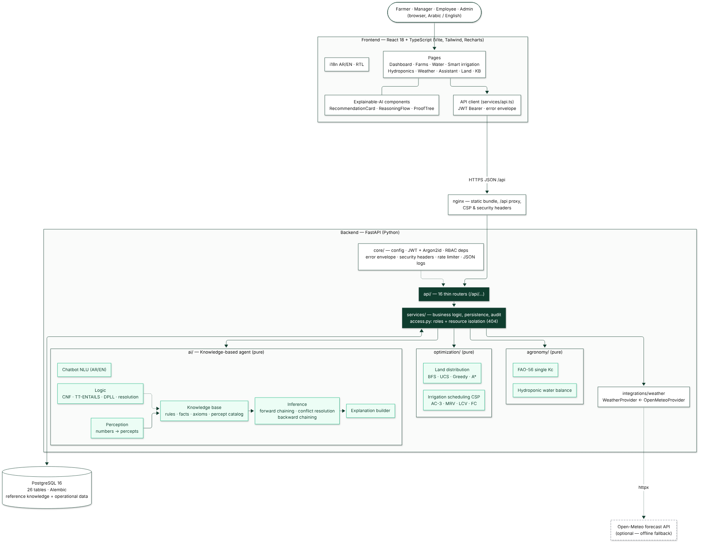

## 02 · Use cases

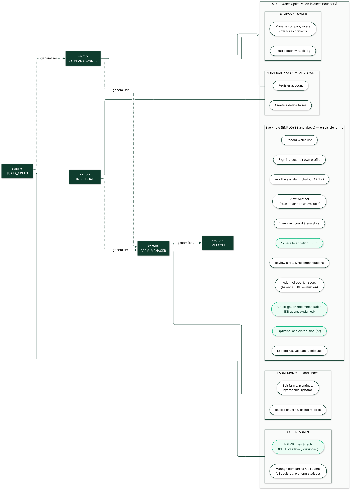

## 03 · Core domain classes

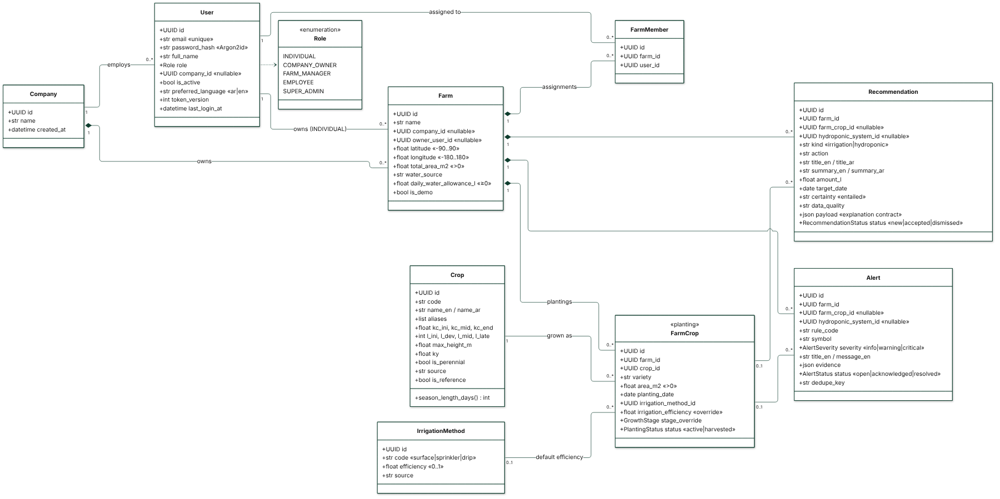

## 04 · Hydroponics

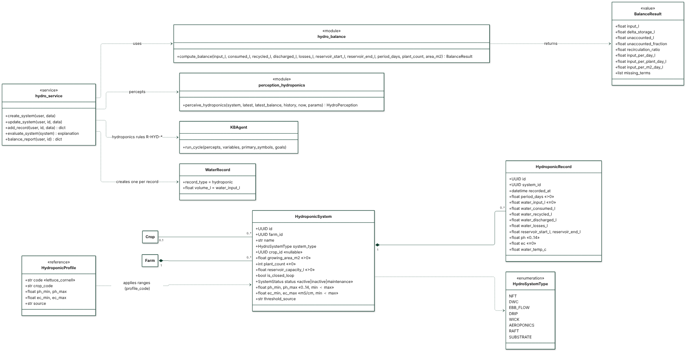

## 05 · Water management

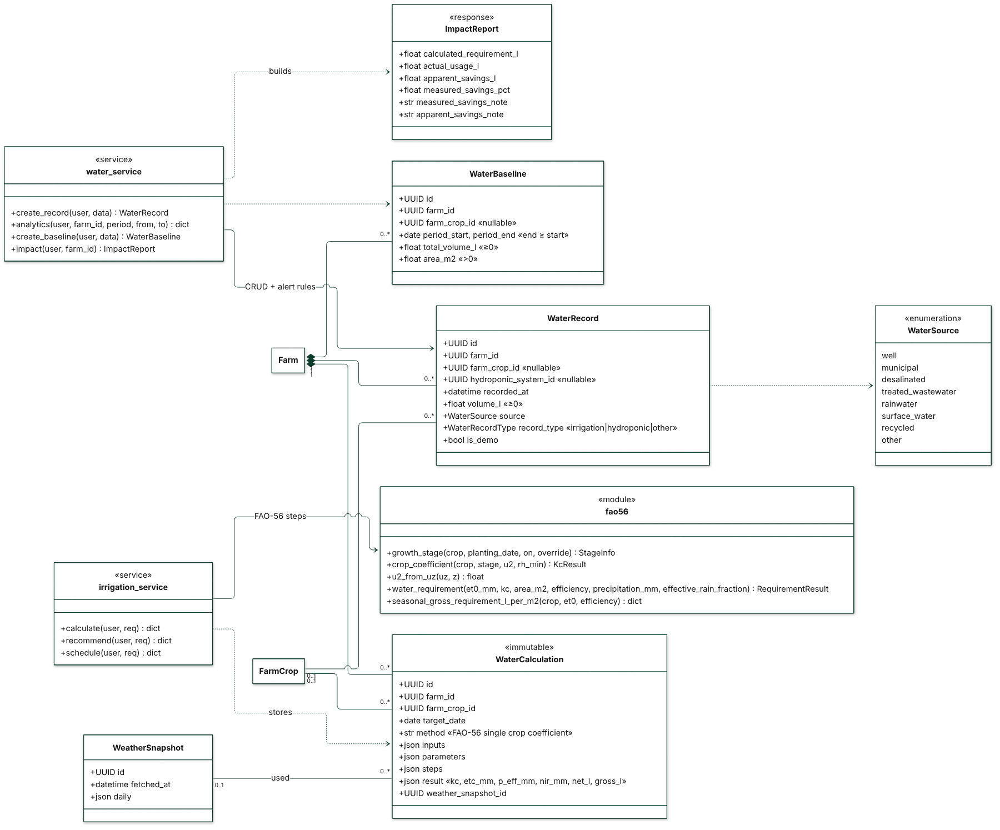

## 06 · Weather service

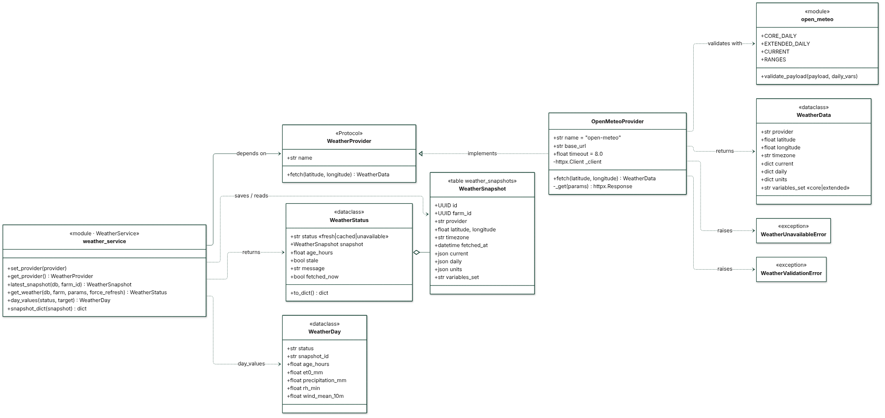

## 07 · Knowledge-based AI

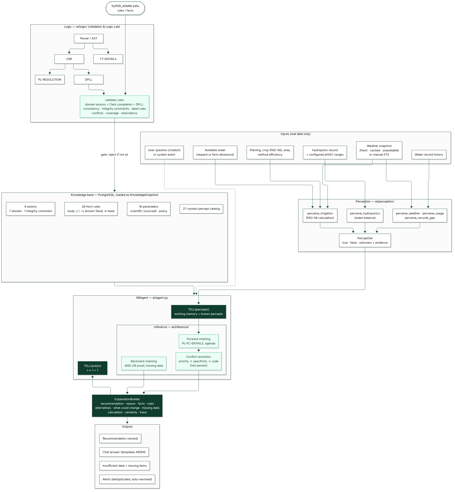

## 08 · Chatbot sequence

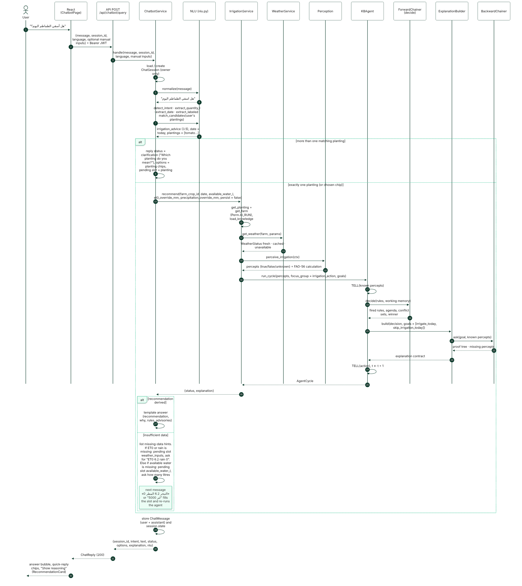

## 09 · Smart irrigation flow

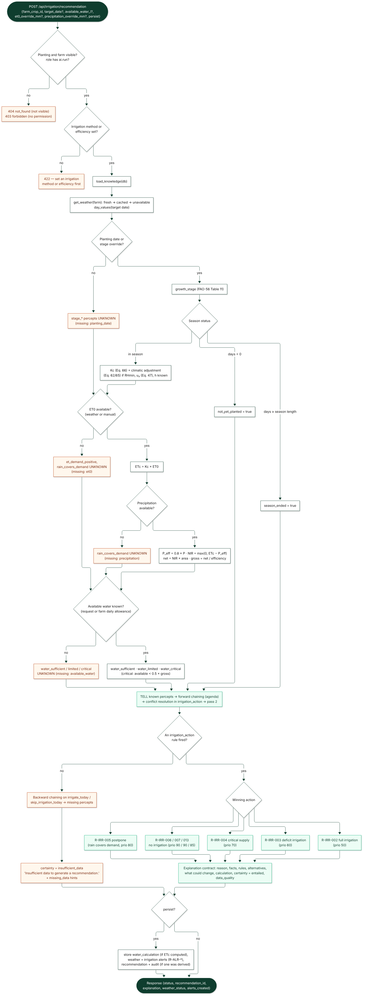

## 10 · Land distribution search

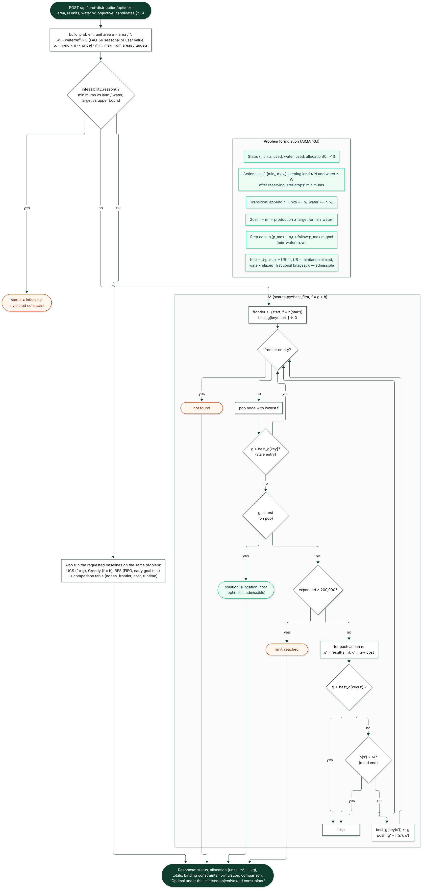

## 11 · Database ER diagram

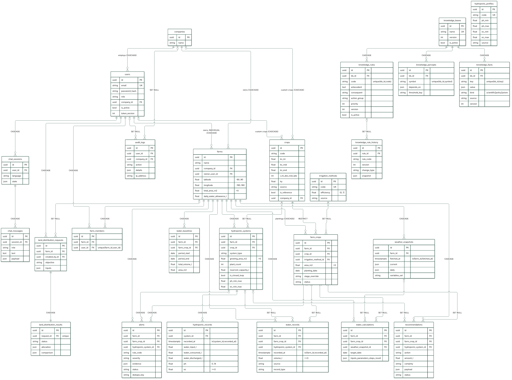

---

## Re-rendering

The diagrams were rendered with `@mermaid-js/mermaid-cli` 12 (Mermaid 12.1) and the pre-installed Chromium:

```bash
# outside the project
mkdir -p /tmp/mmdc && cd /tmp/mmdc && npm init -y
PUPPETEER_SKIP_DOWNLOAD=1 npm install @mermaid-js/mermaid-cli
echo '{"executablePath": "/path/to/chrome", "args": ["--no-sandbox"]}' > puppeteer.json

# from docs/uml
for f in *.mmd; do
  n=${f%.mmd}
  /tmp/mmdc/node_modules/.bin/mmdc -p /tmp/mmdc/puppeteer.json -i $f -o svg/$n.svg -b white
  /tmp/mmdc/node_modules/.bin/mmdc -p /tmp/mmdc/puppeteer.json -i $f -o png/$n.png -b white --size 1800
done
```

`--size` limits the larger side of the PNG; the tall diagrams (02, 07–10) and the ER diagram (11) were rendered with a
larger value (2,100–4,000 px) so that their text stays readable. Each `.mmd` file carries its theme in a YAML front
matter block, so it renders the same way on any Mermaid ≥ 10.5 viewer.
